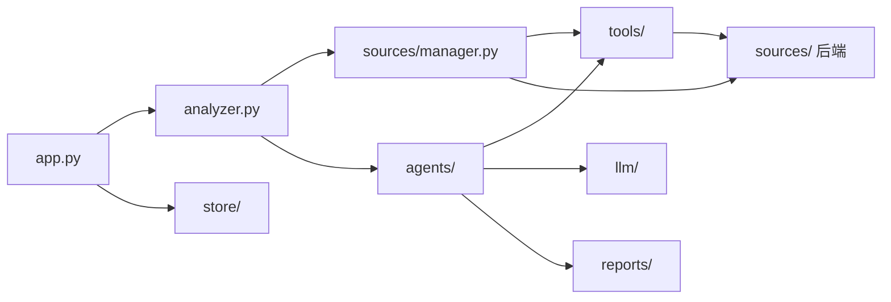

# DHub 源码导读

[app.py](app.py) 提供 FastAPI、网页和运行记录接口。[analyzer.py](analyzer.py) 准备单次运行的资料快照，创建运行时，然后启动聊天或影响分析。其余实现按下表进入对应模块。

| 想找的职责 | 入口 |
| --- | --- |
| Main、Domain、Code 三个 Agent，以及计划和工具执行 | [agents/](agents/README.md) |
| Confluence、Markdown、固定 Git 提交和 CodeGraph | [sources/](sources/README.md) |
| 模型可调用的单项工具及注册 | [tools/](tools/README.md) |
| 角色提示词和共享业务背景 | [prompts/](prompts/README.md) |
| 模型接口和网关适配 | [llm/](llm/README.md) |
| 环境变量、站点 YAML 和默认设置 | [config/](config/README.md) |
| SQLite 分析记录和 Trace 回放 | [store/](store/README.md) |
| 影响报告的结构与证据引用校验 | [reports/](reports/README.md) |
| 桌面端分析页和聊天页 | [static/](static/README.md) |

## 资料调查的依赖

`sources/manager.py` 是单次运行的组装入口，负责把资料快照和调查工具绑定在一起。资料工具调用各自的后端，运行时执行工具并记录 Trace 和证据。报告使用本次运行实际登记的证据 ID。 [完整工作流](../docs/expected-workflow.md) · [本地测试](../tests/README.md)
