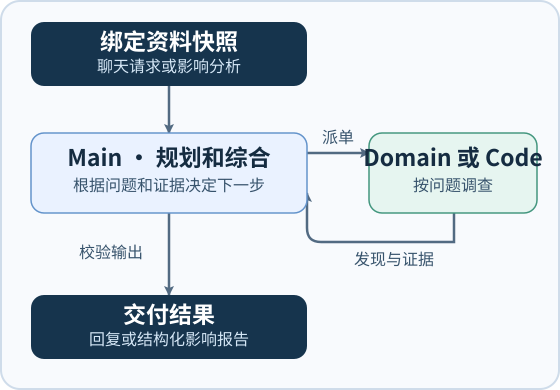

# DHub PoC Agent 职责和工具

V0 通过 LangGraph 调度 Main、Domain 和 Code。两个 Investigator 各有模型上下文、只读工具白名单和 Trace 身份，工具执行与证据登记由 `AgentRuntime` 负责。运行流程和差异以当前代码为准，各角色的目标职责和输出契约见后文。 [Expected Workflow](expected-workflow.md) · [Expected Tools](expected-tools.md)

## 当前 V0 运行流程

`analyze` 在进入 LangGraph 前登记文档和仓库快照。图中的标识符对应 `_run_workflow` 的真实节点，菱形对应 `synthesize` 的条件边。 [编排源码](../dhub/analyzer.py)

### 与 Expected Workflow 的差异

| 环节 | 当前 V0 | Expected Workflow |
| --- | --- | --- |
| 需求规划 | `plan_requirement` 依据原始需求生成 `plan`，再进入 Domain 调查。在线规划提示词要求提供 `business_questions` 和 `code_questions` | 形成结构化需求规划，明确业务调查问题、范围和约束 |
| 首次代码调查 | `investigate_domain` 直接连接 `investigate_code`。Code 读取业务发现，自行组织查询 | Domain 完成后，Main 细化代码任务，再交给 Code。任务明确适用范围、规则与例外、证据引用及要验证的实现 |
| 定向补查 | `synthesize` 在双方首轮调查后可发起一轮补查。任务约定 `agent` 和 `question` | 补查仍回到 Main 综合，任务带上既有发现、相关证据和具体缺口 |
| 证据核对 | `ground_report` 校验引用能否在本次运行中找到，并降级缺证结论 | 进一步核对引用原文是否支持结论的具体范围、规则和因果判断 |

[目标流程图](expected-workflow.md#3-expected-workflow) · [V0 节点对照](expected-workflow.md#61-langgraph-节点与实际交接)

### 首次代码调查如何派单

`investigate_domain` 将调查发现写入 `state["domain"]`。首轮 `code.run` 直接接收原始需求、`plan`、这些业务发现和快照，`task` 为 `None`。在线 `plan` 的 `code_questions` 在业务调查前生成。Domain 返回后，LangGraph 会立即进入 Code，Main 到 Code 完成后的 `synthesize` 才再次运行。业务发现在首轮已能传给 Code，目标流程增加的是中间由 Main 生成验证任务这一步。 [Main](../dhub/agents/main.py) · [Code](../dhub/agents/code.py) · [LangGraph 边](../dhub/analyzer.py)

例如，Domain 在 P5 Step 18 找到 Frequency Cap 的旧豁免后，目标流程会让同一个 Main 先把发现写成验证任务，要求检查 `should_allow_campaign` 的 Outbound 分支、Inbound 的共享调用和 override 配置的适用范围。当前在线 Code 根据收到的业务发现和计划自行确定这些查询。 [目标中的代码任务细化](expected-workflow.md#step-3--refine-code-investigation-taskmain)

### Main 如何再次发起调查

双方首轮调查完成后，`main.synthesize` 会读取需求、plan、两侧发现、原文证据和运行限制。在线模式下，如果尚未补查、工具与时间预算允许，Main 可返回一个任务，用 `agent` 选择 `domain` 或 `code`，用非空 `question` 指定要核实的问题。LangGraph 随即进入 `follow_up_investigation`，追加该角色的发现，设置 `followed_up=True`，再回到 `synthesize` 出报告。离线 Frequency Cap 示例固定补查 Code。

补查补的是首轮之后发现的证据缺口。在线 Domain 入口当前仍传空的 `domain_findings`，在线 Code 入口携带业务发现，历史 Code findings 尚未作为独立上下文传入。目标补查契约会把已有发现和证据一并交给执行角色。 [Domain](../dhub/agents/domain.py) · [Code](../dhub/agents/code.py) · [补查条件与任务格式](../dhub/prompts/main-report.md)

### 运行状态和预算

当前 Graph State 保存 `requirement`、`plan`、`domain`、`code`、`follow_up`、`followed_up`、`report`。在线 plan 和两侧 findings 按提示词返回 JSON，最终 Report 使用 Pydantic 校验。快照、证据、调用计数和时限保存在单次运行的 `AgentRuntime`。在线 Investigator 每次调查最多调用 8 次工具，每次运行合计最多 24 次，分析时限默认 180 秒，可通过 `DHUB_RUN_TIMEOUT` 设置。 [运行时源码](../dhub/agent_runtime.py) · [目标交接契约](expected-workflow.md#4-agent-handoff-contract)

## Main Process Impact Analyser

**目标输入**为用户需求、资料快照和常驻背景。常驻背景包含 Decision Process Baseline、DHub 系统概览、核心术语和分析约束。Baseline 中的阶段、步骤和已知规则保留来源定位。当前在线角色共用含六阶段精简基线的提示词。 [当前共用提示词](../dhub/prompts/common.md)

**目标职责**

1. 保留用户原文，将意图、变更类型、作用对象、渠道或模式、已知条件和假设写入规范化需求。可识别规则新增、修改、删除、配置变更或流程插入点等。
2. 把可能相关的 Process Step 和要查的问题交给 Domain Knowledge Investigator。根据其规则、例外、术语和文档差异，给 Code Investigator 明确的验证任务。
3. 综合两侧调查，说明现有能力对需求的支持情况。对文档所述、代码中观察到的分支和测试断言分别保留来源。若文档和代码对于同一范围描述不同，保留两边证据与适用范围。
4. 在本次运行内建立影响链。例如以 `Outbound Mandatory Campaign 豁免` 出发，找到 P5 Frequency Cap，再核对实现分支、调用方、配置及对应断言。对每一段说明关系、影响原因和证据。上下游顺序用于定位调查，依赖证据用于判断影响。共享调用方可触发隔离验证，下游候选集合变化可触发行为风险，代码修改需求由具体实现证据支持。
5. 发布结构化报告。对关键项校验 `evidence_ids` 来自本次运行已读取的快照并与结论对应。证据不足时降低结论确定性并注明缺什么。对输入太笼统且无法形成调查任务的情况，返回待补充信息。

## Domain Knowledge Investigator

**目标输入**为主 Agent 的业务问题、适用范围和术语，以及运行绑定的 Confluence 快照。它可以使用精简 Baseline 和术语别名来组织调查。V0 在线首轮接收原始需求、plan 和快照。

**调查流程**

1. 分解业务对象、规则别名、例外、渠道和配置，例如分别查 `frequency cap`、`mandate campaign override` 和 `outbound batch`。
2. 用目录、关键词和元数据过滤定位章节，打开完整小节或父文档，核对适用条件、表格、相邻例外和附件线索。
3. 对高影响规则检查相关后续 FD 和引用页。记录同一范围下的差异、明确的覆盖说明，以及仍有疑问的版本。页面版本号、FD 归类与部署状态各有独立语义。按日期或 FD 序号只能找候选文档，覆盖关系需要原文证据。
4. 将业务发现、原文引用、检索范围和代码调查线索交回主 Agent。只有原文可支持的规则陈述才作为已核对的文档事实。计划中的设计保留 `proposed` 状态，实施情况交给代码调查。

**目标输出 `DomainFindings`**

- `rules[]` 包含业务规则、适用范围、例外、涉及的 Phase 和 Step、文档状态及 `evidence_ids`。文档状态可为 `documented`、`proposed`、`superseded` 或 `unknown`。
- `conflicts[]` 包含相关规则或提案、重叠范围、差异和证据。
- `code_hints[]` 给出业务术语、可能的代码命名、配置键或测试场景，供下一步搜索。
- `coverage` 和 `open_questions[]` 记录调查看过的 FD 或页面、资料缺口及需代码验证的问题。

### 知识准备与检索

在分析运行外导入经授权的 Confluence MCP 导出。开发态可以加载合成文件。按快照保存原文 Markdown 和轻量文档目录，使用 `page_id` 加 `version` 标识一份原文。页版本或附件不可取得时在覆盖范围中记录。

文档目录保留标题、Page ID、版本、源 URL、更新时间、更新人（如获准提供）、Ancestors、Feature Drop、章节路径、页面链接和附件元数据。Feature Drop 可由层级派生，主题和摘要可少量人工添加。解析时尽量保留标题层级、表头、接受标准与条件分支。用小节做检索单位，按需读取相邻章节、整页和可用附件。目录摘要和命中片段用于导航，报告证据定位到原文。

V0 在内存中逐节计算关键词分数，依据正文词频、完整查询匹配及标题、章节和元数据关键词排序。BM25 或 FTS 与章节向量融合是 V1 候选，沿用 `search_documents` 的结果格式。 [当前打分与工具契约](expected-tools.md#22-search_documents) · [V1 检索方案](expected-tools.md#25-v1-候选--hybrid-rag)

| 工具 | V0 输入及返回 |
| --- | --- |
| `search_documents` | `query`、可选 FD / Ancestor 过滤、`limit`。返回 Page ID、版本、标题、章节、片段和匹配方式。V0 默认关键词模式 |
| `read_document` | `page_id`、`version`、可选章节。返回原文和元数据，必要时提供阅读窗口和后续位置 |
| `list_documents` | 可按 FD 或 Ancestor 浏览。返回有界的目录记录 |
| `get_document_metadata` | 以 Page ID 和版本返回元数据。若 `read_document` 已返回完整元数据，本次可省略调用 |

沿链接和同级页面探索可先复用目录元数据与上述工具。引用的附件未导入时要记录这个缺口，避免把只读到的页面视为附件内容已核实。

## Code Investigator

**目标输入**为代码调查任务、业务线索和项目仓库的固定快照。任务中应明确要查的现有条件、调用方、配置范围和已有测试。V0 首轮由原始需求、plan 和 Domain findings 提供这些线索。

**调查流程**

1. 获取仓库的身份、分支及提交。索引与提交匹配时，可用 CodeGraph 查找已知符号的实现和调用关系。通过代码或配置名的变体搜索定位其他候选。
2. 阅读关键源文件的带行号上下文，核对真实分支、配置读取、默认值、调用侧限定和测试断言。注释、名称匹配和测试用例的意图分别说明。
3. 利用可用的 CodeGraph 调查 caller、callee、调用链及共享实现，必要时按窗口继续读。核对关键边对应的调用位置。跨 Repo 关系需要可引用的调用、共享契约或配置证据。静态图缺边、动态分派、外部配置和代码快照缺失写入调查限制。
4. 返回提交级实现证据。将现有测试与建议新增测试分别交付，测试断言表示该提交可观察的预期。超过工具覆盖范围的项写入待确认清单。

**目标输出 `CodeFindings`**

- `implementations[]` 记录仓库、符号、观察到的逻辑、适用条件、`evidence_ids`。
- `dependencies[]` 记录调用方和被调用方或共享依赖、关系类型、适用范围和 `evidence_ids`。
- `configurations[]` 和 `existing_tests[]` 记录已读配置使用点、已有测试及其断言，以 `evidence_ids` 定位。
- `coverage` 和 `open_questions[]` 记录实际调查的仓库和提交、代码图可用性和需补证事项。

### MDC Assistant 工具复用

优先迁移已有四个接口，以适配层加上仓库选择、版本和 Trace。工具名称来自现有讨论，真实接口和返回值在集成时核对。

| 工具 | V0 输入及返回 |
| --- | --- |
| `get_repository_metadata` | 以 `repo_id` 取得仓库身份、分支、commit SHA 和可用索引对应的提交。可由本地 Git 或仓库适配器提供 |
| `search_code` | 查询、`repo_ids` 和可选路径或扩展名过滤，返回 `repo + path:line:text`。配置和测试优先复用此入口 |
| `read_file` | 指定仓库、相对路径和行号窗口，读取绑定提交的带行号源码或配置 |
| `codegraph_explore` | 指定仓库和调查目标，返回相关源码或静态关系，以及可继续读取的 `result_id` |
| `codegraph_read_result` | 指定当前运行的 `result_id` 与窗口，只读取已捕获结果，沿用原结果的仓库和提交 |

在同一运行中锁定仓库提交与知识快照。CodeGraph 不可用或索引提交不匹配时，转用搜索和源文件核对并标明图覆盖缺失。工具只能访问已配置的语料和仓库，服务端负责校验路径、返回限制和超时。Demo 模式使用合成资料上的工具执行；项目模式依据实际接入情况报告。

## 调查和证据的关系

在线分析时建立一次运行内的业务到技术关联并保存在报告中。`read_document` 和 `read_file` 的原文证据带有本次运行的证据 ID 和工具调用 ID。比如文档定义豁免条件，代码读取确认配置和分支，测试阅读确认已有断言，从而支持主 Agent 解释为什么直改共享函数可能影响 Inbound。当前报告校验会剔除未知引用、降级缺证的已确认结论。结论是否得到引用原文支持仍需核对。 [报告与 Trace 契约](api-ui-trace.md) · [报告校验源码](../dhub/report.py)
