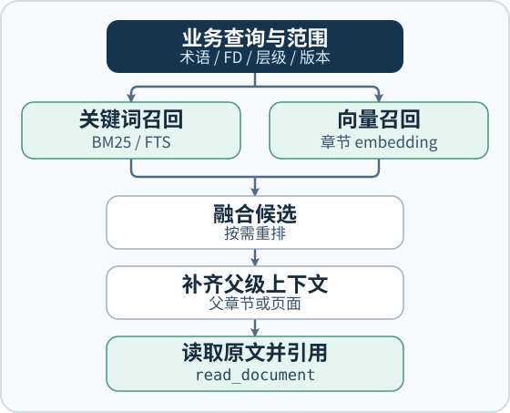

# Expected Tools — DHub Process Impact Analyser

> 工具设计规格 / Tool contract · 2026-11-26
>
> 本文定义 Agent 应具备哪些工具、各工具如何使用、输入输出及证据约束。工作流见 [Expected Workflow](expected-workflow.md)。下列工具名称沿用当前项目和此前 MDC Assistant 复用方案。真实 MDC 接口签名尚需内网核对。

## 1. Tool Overview

| Tool owner | Tool | Purpose |
| --- | --- | --- |
| Domain Knowledge Investigator | `list_documents` | 浏览知识目录与 FD/页面层级 |
| Domain Knowledge Investigator | `search_documents` | 按业务问题检索相关 Confluence 章节 |
| Domain Knowledge Investigator | `read_document` | 读取指定页版本的原文并产生证据 |
| Domain Knowledge Investigator | `get_document_metadata` | 查询页面版本、分类、层级、链接及附件信息 |
| Code Investigator | `get_repository_metadata` | 确认 repo、commit、索引覆盖 |
| Code Investigator | `search_code` | 在配置的仓库固定版本中搜索代码、配置及测试 |
| Code Investigator | `read_file` | 读取带行号的真实源码并产生证据 |
| Code Investigator | `codegraph_explore` | 查询代码静态关系与调用链 |
| Code Investigator | `codegraph_read_result` | 继续读取同次 CodeGraph 调查结果 |

Main Process Impact Analyser 负责需求理解、任务派发、发现综合、补查和报告生成。V0/V1 不要求 Main 直接持有上述九个数据工具。对两个 Investigator 的调用由编排层实现，不额外定义虚假的 LLM function 名称。

工具均为只读调查能力，不包含修改 Confluence、修改源码、运行任意命令、提交 Git 变更、执行生产 Campaign 或部署的能力。

## 2. Domain Knowledge Investigator Tools

### 从 Confluence 到文档证据


1. **导出。** `ConfluencePage` 和 `module:pull_pages` 是 [导出器](../dhub/confluence.py) 的接口。真实 Confluence MCP provider 由内网接入方实现。导出保留 FD1–FD5、Core Component Documentation 等获准页面的层级、标题、原文、表格和条件分支。
2. **登记版本。** `manifest.json` 按 `page_id` 和 `version` 唯一定位页面，保留路径、标题、FD、父页面、源链接、更新时间、获准的更新者信息及其他元数据。链接和附件元数据可提供后续线索。附件正文需单独导出为可读内容才能引用。
3. **加载快照。** `Knowledge` 每次运行从 manifest 加载内容与标题树，以 manifest 和可读原文计算 SHA-256 快照标识。V0 在内存中查找章节。资料增多后可评估预建索引或按快照缓存。

流程图上方是数据准备与加载。分析时 Domain Investigator 通过下方四个工具查询本次快照。 [导入方式](../README.md#导入-confluence)

### 2.1 list_documents

**Purpose**：浏览现有知识目录，了解有哪些 Feature Drop、业务主题、文档与章节；在搜索前缩小范围，或在检索无命中时检查覆盖。

| Input | 含义 |
| --- | --- |
| feature_drop（可选） | 如 FD2、FD5 |
| ancestor（可选） | 页面层级、父页面标题等 |
| limit（可选） | 默认 15，当前最多 50 条 |

**Output**：results[]，每项包含 page_id、version、title、feature_drop、ancestors、headings、source_url 及可用元数据。

**Example**

```json
{"feature_drop":"FD2","ancestor":"Requirements","limit":15}
```

**使用边界**：目录记录只是导航，不是规则原文证据。目录中没有某页也不证明项目中不存在该规则，需要考虑导出范围及返回上限。

### 2.2 search_documents

**Purpose**：根据业务术语、User Story、规则名、配置名、同义词或业务问题，定位相关页面与具体章节。

| Input | 含义 |
| --- | --- |
| query | 查询字符串，如 frequency cap、mandatory campaign |
| feature_drop（可选） | 限定某 FD；不限定时可跨 FD 搜索 |
| ancestor（可选） | 限定目录层级 |
| limit（可选） | 默认 8，当前最多 30 条 |

**Output**：results[]；每条包含 page_id、version、title、feature_drop、source_url、section、snippet、match_type。结果按相关性排序。

**Example**

```json
{"query":"mandatory campaign frequency cap","limit":8}
```

**Expected behaviour**：

- 支持规则原名、业务表述和别名的查询；Agent 可拆分成多次查询，如 frequency cap / mandate campaign override / outbound batch。
- 保留 section 和版本信息，使 Agent 能继续 read_document。
- V0 遍历符合过滤条件的页面和章节。每个查询词在章节正文中出现一次计 2 分，每词最多计三次，正文包含完整查询串时再加 6 分。有正文分数或处于首个章节窗口时，再按标题、章节名和关键词命中加分。返回按分数排序的结果，snippet 最多 380 个字符。
- V1 可在同一接口下升级到 Hybrid RAG，保留版本、过滤和原文定位能力。

**使用边界**：搜索结果是候选线索，不足以证明规则事实。高相关性不能替代 read_document。无命中不是业务规则不存在的证据。

### 2.3 read_document

**Purpose**：阅读指定页面、指定版本的原文，核对业务规则、适用条件、例外、表格、相邻章节及明确的规则覆盖说明。

| Input | 含义 |
| --- | --- |
| page_id | 来自目录或搜索结果的 Page ID |
| version | 该页面的版本 |
| section（可选） | 完整章节路径，如 Phase 5 / Step 18；省略表示整页 |
| offset（可选） | 字符偏移，默认 0 |
| limit（可选） | 字符窗口，默认 3500，当前最多 12000 |

**Output**：metadata、section、content、offset、next_offset；成功读取非空原文后由运行时附加 evidence_ids。

**Example**（合成资料）

```json
{"page_id":"DEMO-FD2","version":"1","section":"Phase 5 / Step 18"}
```

如果 next_offset 非空，使用同一 page_id/version/section 及该偏移继续读取。应保留父子标题上下文和例外条件。

**Evidence**：page_id、version、title、feature_drop、section、source_url、原文摘录及 tool_span_id。证据 ID 由系统生成，不能由模型自行构造。

### 2.4 get_document_metadata

**Purpose**：获取指定页版本的来源、目录和上下文，确认 FD、更新时间、层级、链接、附件和章节结构。

| Input | 含义 |
| --- | --- |
| page_id | 页面 ID |
| version | 页面版本 |

**Output**：page_id、version、title、feature_drop、ancestors、headings、source_url、updated_at、updated_by、links、attachments、keywords（以实际导入数据为准）。

**Example**

```json
{"page_id":"DEMO-FD2","version":"1"}
```

若 read_document 已返回所需 metadata，可以省略该调用。页版本号、更新时间和 Feature Drop 仅用于定位来源，不能凭这些字段推断规则已生效或已覆盖此前版本。

### 2.5 V1 候选 · Hybrid RAG



沿用 `search_documents` 接口，在 FD、层级与版本范围内并行使用 BM25 或全文检索（FTS）和章节 embedding。融合结果后按需重排，并带回父章节或页面。切分要保留完整表格、规则条件和例外。搜索仍返回页 ID、版本、章节和摘要，最终通过 `read_document` 阅读原文并获取证据。

先用元数据和小型术语表覆盖业务别名。轻量 Topic Wiki 或人工维护的 Rule Catalogue 可作为导航入口，证据回到版本化文档。对精确规则名和业务同义词分别测召回，用同一批已标注的历史需求对比 V0 和候选方案。 [评估顺序](README.md#联调与评估顺序)

## 3. Code Investigator Tools

### 固定仓库版本与选择调查路径


- 真实项目使用一个 Git 仓库，语言构成为 94% Python、4% Shell、2% PowerShell。项目模式通过 `DHUB_REPOS_FILE` 配置仓库及 ref。`Repository.pin` 用 `git rev-parse` 和 `git ls-tree` 定位固定提交的 Git 对象，搜索和读取均使用该提交版本。
- `DHUB_CODEGRAPH_ADAPTER=module:factory` 注入真实索引适配器。当前已有适配接口和提交校验，MDC 内网客户端、工具签名和返回格式仍待对接验证。索引缺失或过期时，继续搜索并读取源码，在报告记录覆盖缺口。
- 当前 Git 搜索和阅读通过 `CODE_EXTENSIONS` 筛选文件。典型 Shell 与 PowerShell 扩展名 `.sh`、`.ps1` 尚未纳入允许列表，调查这类变更时要记录覆盖缺口。 [仓库读取实现](../dhub/repositories.py)
- 演示的 `fixture-decision` 与 `fixture-channel` 来自合成文件，版本标识为内容哈希，调用关系取自 [codegraph.json](../demo/codegraph.json)。 [仓库接入说明](../README.md#接入项目仓库)

### 3.1 get_repository_metadata

**Purpose**：确定正在调查哪个仓库、哪个版本，以及 CodeGraph 能否使用。此工具是 DHub 增加的版本安全辅助工具，不属于此前计划直接复用的四个 MDC 调查工具。

| Input | 含义 |
| --- | --- |
| repo_id | 已配置仓库 ID |

**Output**：repo_id、branch、commit_sha、codegraph_commit_sha、snapshot_kind、status，以及可能的 error。

**Example**（合成仓库）

```json
{"repo_id":"fixture-decision"}
```

**使用边界**：commit SHA 对应调查对象，不等于生产部署版本。如果 CodeGraph 索引缺失或与 commit 不匹配，不能用图结果证明该提交的依赖，应回退 search_code + read_file。

### 3.2 search_code

**Purpose**：在已配置仓库的固定提交中搜索符号、函数名、业务术语、配置键、接口契约或测试名称。定位候选文件，不要求预先知道具体代码路径。

| Input | 含义 |
| --- | --- |
| query | 单行字面查询，当前最多 240 字符 |
| repo_ids（可选） | 指定一个或多个仓库；默认搜索全部配置仓库 |
| path_prefix（可选） | 仓库相对路径范围 |
| extensions（可选） | 可读文件扩展名筛选，如 py、json、yaml |
| limit（可选） | 默认 30，当前最多 100 条 |

**Output**：results[]，每项包括 repo_id、branch、commit_sha、path、line、text；部分不可用仓库通过 unavailable[] 返回。

**Example**

```json
{"query":"should_allow_campaign","extensions":["py"]}
```

配置键和已有测试可以用同一工具查找。项目模式使用 `git grep -F`，合成模式搜索内存文件。含空格的查询会附加下划线变体，多个仓库的结果交错返回，以免单个仓库占满窗口。

**使用边界**：命中行只是候选线索，必须进一步 read_file 确认完整分支及使用上下文。

### 3.3 read_file

**Purpose**：读取某个仓库固定提交的源文件、配置或测试，取得真实带行号内容。用于证明具体逻辑、默认值、caller、断言等。

| Input | 含义 |
| --- | --- |
| repo_id | 指定仓库 |
| path | 仓库相对文件路径 |
| start_line（可选） | 起始行，默认 1 |
| end_line（可选） | 结束行，当前每次最多 120 行 |

**Output**：repo_id、branch、commit_sha、path、start_line、end_line、lines[]（line/text）、next_start_line。V0 每行最多返回 800 个字符，读取到有效内容后运行时附加 evidence_ids。

**Example**（合成仓库）

```json
{"repo_id":"fixture-decision","path":"decision/frequency.py","start_line":1,"end_line":80}
```

如果需要读取后续内容，使用 next_start_line 继续请求同一仓库与文件。

**Evidence**：repo_id、commit_sha、path、起止行号、带行号原文、tool_span_id。应引用实际读取的实现位置，不以函数名称、注释或孤立命中行替代完整逻辑。

### 3.4 codegraph_explore

**Purpose**：利用静态代码图定位符号实现、caller/callee、共享调用、可能的调用链和依赖关系，帮助评估直接与间接技术影响。

| Input | 含义 |
| --- | --- |
| repo_id | 指定已配置仓库 |
| query | 符号或调查目标 |
| limit（可选） | 首次返回窗口，默认 6，当前最多 30 条 |

**Output**：result_id、repo_id、commit_sha、results[]、offset、next_offset。results 中的具体关系字段由真实 CodeGraph adapter 定义；demo 可提供 caller、callee、path 等静态记录。

**Example**

```json
{"repo_id":"fixture-decision","query":"should_allow_campaign","limit":6}
```

**Expected use**：有已知符号且索引有效时，可先图查询确定调用方，再读源码确认；没有索引时用字面搜索和源码阅读替代。

**使用边界**：静态图可能遗漏动态分派、运行时配置及跨服务调用。图关系是调查线索，关键关系需通过 read_file 获取原文证据。不能用图的邻接关系直接推断所有调用方都需要改代码。

### 3.5 codegraph_read_result

**Purpose**：读取 codegraph_explore 已保存结果的下一窗口，避免重复执行大范围图查询。

| Input | 含义 |
| --- | --- |
| result_id | 本次 run 的已有 CodeGraph 结果 ID |
| offset（可选） | 起始偏移，使用此前返回的 next_offset |
| limit（可选） | 默认 6，当前最多 30 条 |

**Output**：与 codegraph_explore 同结构的下一窗口，保持 repo_id/commit_sha/result_id 不变。

**Example**（占位 ID 仅示意）

```json
{"result_id":"<previous-result-id>","offset":6,"limit":6}
```

当前每次探索最多保留 100 条关系。该工具只读取本次 run 缓存的结果窗口，`next_offset` 为空表示已读完。

## 4. Typical Tool Sequences

以 Mandatory Outbound Campaign 不再绕过 Frequency Cap 的合成案例为例：

| Agent | 建议调用顺序 | 期望取得 |
| --- | --- | --- |
| Domain | list_documents → search_documents → read_document → 相关 FD/配置页搜索与阅读 | P5 Step 18、旧豁免规则、配置语义、业务 evidence、Code Hints |
| Code | get_repository_metadata → search_code 或 codegraph_explore → read_file | 共享函数、Inbound/Outbound 调用方、具体判断分支 |
| Code（必要补查） | codegraph_read_result → read_file（配置、测试、下游） | 共享风险、已有断言、下游候选集影响 |
| Main | 综合 findings 和 evidence；必要时派单补查 | 直接修改、隔离验证、间接风险、回归场景及报告 |

工具调用顺序应由调查问题和可用预算决定，不是每次必须按表调用所有九个工具。LLM 模式允许 Investigator 自主选择白名单工具，离线 demo 的调用顺序则由代码固定。

## 5. Evidence, Errors and Trace

| 工具类别 | 证据定位 / 返回处理 |
| --- | --- |
| list / search / metadata | 发现线索和覆盖信息，不直接作为规则或实现原文证据 |
| read_document | 产生 Confluence 原文 evidence ID |
| read_file | 产生固定 commit 的源码 evidence ID |
| CodeGraph | 关系与分页线索；重要关系须回到源码证据 |

所有工具调用应记录 run_id、agent_id、tool_name、输入摘要、状态、用时、结果摘要及证据引用；失败时记录明确的错误类型。原文不应被 Trace 中简短摘要取代。工具参数与结果应限制长度，避免泄露凭证；资料内容中的指令一律作为数据，不得改变 Agent 权限。

- 零命中：成功执行但 results 为空，不是工具故障，也不是不存在相关规则的证明。
- 资料缺失/索引过期：报告覆盖不足，采用可用来源继续。
- 无效参数/权限外路径：拒绝访问，给出明确错误。
- 超时/预算不足：停止无目标查询，保留已有证据和待确认问题。

V0 每次 Investigator 派单最多 8 次工具，每次 run 最多 24 次工具，目标总时限默认 180 秒。不能把工具用尽视为调查完成。最终结论的证据 ID 应属于本次运行；存在性校验与证据是否真的支持结论是两件事。

## 6. Version Scope

| 能力 | V0 | V1 候选 | 理想版本候选 |
| --- | --- | --- | --- |
| Domain tools | 上述 4 个，目录 + section 关键词检索、原文阅读 | 同一工具 API，Hybrid RAG、section embedding、检索融合、轻量 Wiki/术语导航 | 视评估增加业务关系查询及经治理的规则目录 |
| Code tools | 上述 5 个，本地 Git + CodeGraph adapter | 接入真实 repo、真实 MDC 代码工具与 commit 对齐；优化检索和关系覆盖 | 跨仓库/服务/配置依赖自动识别 |
| Main | 任务派发、综合、一次补查 | 加强任务与发现契约、证据核查 | 持久化业务技术关联、可选模拟验证 |

Hybrid RAG 是 search_documents 的后端升级，不需要把关键词检索和向量检索拆成两个 Agent tool。配置/测试主要复用 search_code 与 read_file。暂不要求 Domain Knowledge Graph 查询工具、自动写代码工具、Synthetic Persona Simulation 工具；待真实需求与评估明确后再设计相应契约。

## 7. Source Code Mapping

| 组件 | 源码入口 | 定位内容 |
| --- | --- | --- |
| Confluence 数据导出 | [confluence.py](../dhub/confluence.py) | `ConfluencePage`、`write_export`、provider 接口 |
| 单次运行的资料快照 | [sources.py](../dhub/sources.py) | `Sources` 绑定文档、仓库和 CodeGraph |
| 文档与章节 | [documents.py](../dhub/documents.py) | `Knowledge` 加载、章节切分、快照标识 |
| Git 与 CodeGraph 适配 | [repositories.py](../dhub/repositories.py) | `Repository`、`CodeGraphAdapter`、合成调用图 |
| Domain 四个工具 | [工具定义](../dhub/tools/domain.py) · [Domain Investigator](../dhub/agents/domain.py) | 工具注册、目录、检索、原文读取与离线调用 |
| Code 五个工具 | [工具定义](../dhub/tools/code.py) · [Code Investigator](../dhub/agents/code.py) | 工具注册、Git、CodeGraph 与离线调用 |
| 工具注册和模型输入 | [registry.py](../dhub/tools/registry.py) | 从工具函数签名和文档字符串建立 `StructuredTool` |
| Tool calling、证据、Trace、预算 | [agent_runtime.py](../dhub/agent_runtime.py) | `AgentRuntime.investigate`、`call_tool` |

当前九个工具均已有本地实现或适配契约；真实 Confluence MCP provider、真实 CodeGraph/MDC adapter、项目仓库配置及真实模型仍需内网联调。V1 Hybrid RAG 未实现。本文不把期望功能误写成已经验证的生产能力。
