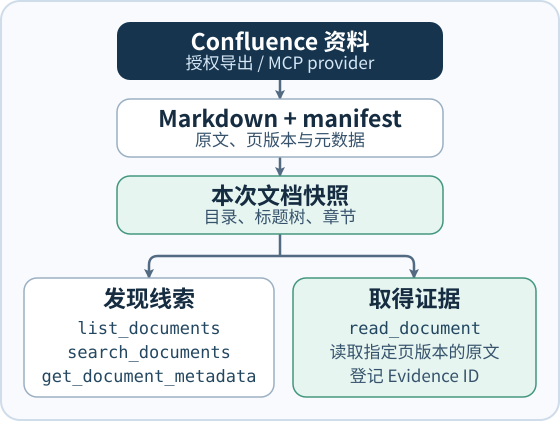
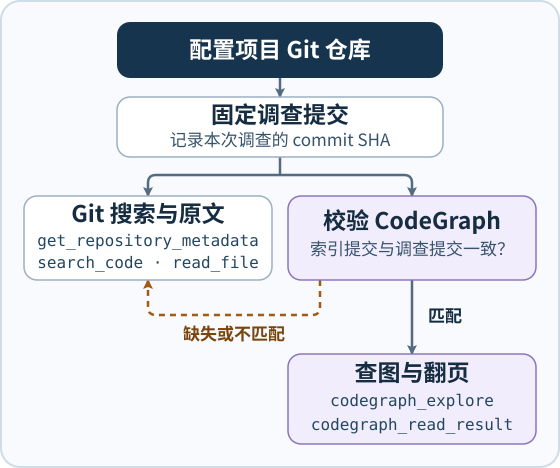

# Expected Tools — DHub Process Impact Analyser

> 工具设计规格 / Tool contract · 2026-11-27
>
> 本文定义 Agent 可使用的工具、输入输出及证据约束。工作流见 [Expected Workflow](expected-workflow.md)。CodeGraph 的内网目标是复用 MDC Assistant 的工具实现与底层模块，实际调用签名需按内网源码确认。

## 1. Tool Overview

| Tool owner | Tool | Purpose |
| --- | --- | --- |
| Main Process Impact Analyser | [investigate_domain](../dhub/tools/investigate_domain.py) | 派发业务规则或流程调查 |
| Main Process Impact Analyser | [investigate_code](../dhub/tools/investigate_code.py) | 派发实现、配置、调用依赖或测试调查 |
| Main Process Impact Analyser | [update_plan](../dhub/tools/update_plan.py) | 创建或修订本次运行的调查计划 |
| Domain Knowledge Investigator | [list_documents](../dhub/tools/list_documents.py) | 浏览知识目录与 FD/页面层级 |
| Domain Knowledge Investigator | [search_documents](../dhub/tools/search_documents.py) | 按业务问题检索相关 Confluence 章节 |
| Domain Knowledge Investigator | [read_document](../dhub/tools/read_document.py) | 读取指定页版本的原文并产生证据 |
| Domain Knowledge Investigator | [get_document_metadata](../dhub/tools/get_document_metadata.py) | 查询页面版本、分类、层级、链接及附件信息 |
| Code Investigator | [get_repository_metadata](../dhub/tools/get_repository_metadata.py) | 确认 repo、commit、索引覆盖 |
| Code Investigator | [search_code](../dhub/tools/search_code.py) | 在配置的仓库固定版本中搜索代码、配置及测试 |
| Code Investigator | [list_files](../dhub/tools/list_files.py) | 按固定提交、目录和 glob 查找文件名 |
| Code Investigator | [read_file](../dhub/tools/read_file.py) | 读取带行号的真实源码并产生证据 |
| Code Investigator | [codegraph_explore](../dhub/tools/codegraph_explore.py) | 查询代码静态关系与调用链 |
| Code Investigator | [codegraph_read_result](../dhub/tools/codegraph_read_result.py) | 继续读取同次 CodeGraph 调查结果 |

Main Process Impact Analyser 通过上表的三个模型工具规划和派单。两位 Investigator 各自持有对应的资料工具白名单。

资料工具在本次运行绑定的文档和仓库快照上执行只读调查。

### 1.1 Investigator delegation

`investigate_domain(question, task_id=None)` 和 `investigate_code(question, task_id=None)` 接收有范围的具体问题。显式计划中的派单要提供当前计划里属于该 Investigator 的 `task_id`，隐式调查省略它。被派的 Agent 同时看到原始请求、当前计划（如有）、两侧已有发现和资料快照。后续派单附带同一 Investigator 在本次运行中最近 8 次搜索的查询、范围、状态和返回条数。结果将本次 findings、新登记的 evidence 及可用性限制送回 Main。

### 1.2 update_plan

每次提交完整的计划快照。可在首轮建立，也可在任何一轮调查之后建立或更新。

| Input | 含义 |
| --- | --- |
| `goal` | 当前公开的调查目标 |
| `scope`（可选） | 最多 8 项范围或约束，每项为名称和文本 |
| `candidate_steps`（可选） | 最多 12 个待核对的流程位置 |
| `tasks` | 1–20 项调查任务，包含唯一 `id`、`agent`（`domain` 或 `code`）、`question`、`status` 和可选 `note` |
| `reason` | 本次建计划或修改的公开原因 |

状态为 `pending`、`in_progress`、`completed`、`blocked` 或 `skipped`。同一任务应沿用 ID，阻塞和跳过需要 `note`。应根据已经取得的证据确认任务是否完成。

成功时返回带递增 `version` 的 `plan`。任务的 `evidence_ids` 由运行时从实际证据生成，保留同一任务 ID 的关联。每份有变化的快照发出 `plan.updated`。形状校验失败时返回 `invalid_arguments`，已接受的计划继续有效。此工具使用独立预算。 [事件格式](api-ui-trace.md#调查计划事件) · [输入模型](../dhub/planning.py)

## 2. Domain Knowledge Investigator Tools

### 从 Confluence 到文档证据



1. **导出。** 内网沿用现有 Confluence 导出。`ConfluencePage` 和 `module:pull_pages` 是可用的导出器接口。导出保留 FD1–FD5、Core Component Documentation 等获准页面的层级、标题、原文、表格和条件分支。 [导出器](../dhub/confluence.py) · [现有数据对接](intranet-poc-handoff.md)
2. **登记版本。** `manifest.json` 按 `page_id` 和 `version` 唯一定位页面，保留路径、标题、FD、父页面、源链接、更新时间、获准的更新者信息及其他元数据。链接和附件元数据可提供后续线索。附件正文需单独导出为可读内容才能引用。
3. **加载快照。** `Knowledge` 每次运行从 manifest 加载内容与标题树，以 manifest 和可读原文计算 SHA-256 快照标识。加载时按章节预计算规范化正文和关键词。首标题之前的内容与无标题页面均进入搜索范围。

流程图上方是数据准备与加载。分析时 Domain Investigator 通过下方四个工具查询本次快照。 [导入方式](../README.md#导入-confluence)

### 2.1 list_documents

**Purpose**：浏览现有知识目录，了解有哪些 Feature Drop、业务主题、文档与章节；在搜索前缩小范围，或在检索无命中时检查覆盖。

| Input | 含义 |
| --- | --- |
| feature_drop（可选） | 如 FD2、FD5 |
| ancestor（可选） | 页面层级、父页面标题等 |
| limit（可选） | 默认 15，当前最多 50 条 |
| offset（可选） | 从匹配目录的第几项开始，默认 0 |

**Output** 包含 `total`、`returned`、`has_more`、`next_offset`、`status` 和 `warnings`。`results[]` 每项包含 page_id、version、title、feature_drop、ancestors、headings、source_url 及可用元数据。`total` 统计快照中可读且符合筛选条件的目录项。用相同筛选条件和 `next_offset` 读取下一页。

**Example**

```json
{"feature_drop":"FD2","ancestor":"Requirements","limit":15,"offset":0}
```

**使用边界**：目录记录只是导航，不是规则原文证据。目录中没有某页也不证明项目中不存在该规则，需要考虑导出范围及返回上限。

### 2.2 search_documents

**Purpose**：根据业务术语、User Story、规则名、配置名、同义词或业务问题，定位相关页面与具体章节。

| Input | 含义 |
| --- | --- |
| query | 查询字符串，如 frequency cap、mandatory campaign |
| feature_drop（可选） | 限定某 FD；不限定时可跨 FD 搜索 |
| ancestor（可选） | 限定目录层级 |
| page_id / version（可选） | 限定页面，且可进一步限定该页的具体版本 |
| limit（可选） | 默认 8，当前最多 30 条 |

**Output** 使用 [搜索状态契约](#搜索状态)。每条结果含 `page_id`、`version`、`title`、`feature_drop`、`source_url`、`section_id`、`section_path`（亦返回为 `section`）和 `parent_section_id`。`start_line`、`end_line` 是被检索的章节范围，`match_line` 是片段的原文行号，`read_end_line` 包含父章节下的子章节。仅元数据命中时 `match_line` 可为空。`snippet` 最多 380 字符。

**Example**

```json
{"query":"mandatory campaign frequency cap","limit":8}
```

**Expected behaviour**：

- 调查员可按规则原名和术语搜索，必要时用术语表改写查询，如 frequency cap、mandate campaign override 或 outbound batch。
- 同页同版本内，`section_id` 由章节起始行确定。`page_id`、`version` 和 `section_id` 一起定位原文。
- 命中完整短语时章节路径、正文、页面标题分别加 24、16、12 分。不同查询词命中章节路径、正文、标题或关键词分别加 6、4、2、1 分。同一字段内重复出现的词按一次计分。跨页和页面内均按相关性排序。
- V1 可在同一接口下升级到 Hybrid RAG，保留版本、过滤和原文定位能力。

**使用边界**：搜索结果是候选线索，不足以证明规则事实。高相关性不能替代 read_document。无命中不是业务规则不存在的证据。

### 2.3 read_document

**Purpose**：阅读指定页面、指定版本的原文，核对业务规则、适用条件、例外、表格、相邻章节及明确的规则覆盖说明。

| Input | 含义 |
| --- | --- |
| page_id | 来自目录或搜索结果的 Page ID |
| version | 该页面的版本 |
| section_id（可选） | 搜索命中里的章节 ID，优先用于定位 |
| section（可选） | 兼容唯一的完整章节路径，如 Phase 5 / Step 18。遇到同名章节时用 ID。两个参数均省略时读取整页 |
| offset（可选） | 字符偏移，默认 0 |
| limit（可选） | 字符窗口，默认 3500，当前最多 12000 |

**Output** 包含 `metadata`、`section`、`section_id`、`content`、`start_line`、`end_line`、`offset`、`end_offset`、`truncated` 和 `next_offset`。运行时为非空原文窗口登记 `evidence_ids`。

**Example**（合成资料）

```json
{"page_id":"DEMO-FD2","version":"1","section":"Phase 5 / Step 18"}
```

使用同一页版本、章节 ID 和 `next_offset` 继续读取。父章节的读取窗口包含子章节。`start_line` 和 `end_line` 标记本次返回的原文行号。

**Evidence** 包含页 ID、版本、标题、Feature Drop、章节 ID 和路径、实际读取的行号和偏移、原文摘录、源链接及 `tool_span_id`。证据 ID 由运行时生成。

### 2.4 get_document_metadata

**Purpose**：获取指定页版本的来源、目录和上下文，确认 FD、更新时间、层级、链接、附件和章节结构。

| Input | 含义 |
| --- | --- |
| page_id | 页面 ID |
| version | 页面版本 |

**Output**：page_id、version、title、feature_drop、ancestors、headings、source_url、updated_at、updated_by、links、attachments、keywords（以实际导入数据为准）。

**Example**

```json
{"page_id":"DEMO-FD2","version":"1"}
```

若 read_document 已返回所需 metadata，可以省略该调用。页版本号、更新时间和 Feature Drop 仅用于定位来源，不能凭这些字段推断规则已生效或已覆盖此前版本。

### 2.5 V1 候选 · Hybrid RAG


沿用 `search_documents` 接口，在 FD、层级与版本范围内并行使用 BM25 或全文检索（FTS）和章节 embedding。融合结果后按需重排，并带回父章节或页面。切分要保留完整表格、规则条件和例外。搜索仍返回页 ID、版本、章节和摘要，最终通过 `read_document` 阅读原文并获取证据。

先用元数据和小型术语表覆盖业务别名。轻量 Topic Wiki 或人工维护的 Rule Catalogue 可作为导航入口，证据回到版本化文档。对精确规则名和业务同义词分别测召回，用同一批已标注的历史需求对比 V0 和候选方案。 [评估顺序](README.md#联调与评估顺序)

## 3. Code Investigator Tools

### 固定仓库版本与选择调查路径



- Decision Process 主要实现位于 `decision-engine-instant-decision-svc` 的 `dev` 分支。项目模式通过 `DHUB_REPOS_FILE` 配置仓库及 ref。`Repository.pin` 用 `git rev-parse` 和 `git ls-tree` 定位固定提交的 Git 对象，搜索和读取均使用该提交版本。
- `DHUB_CODEGRAPH_ADAPTER=module:factory` 注入项目侧适配器。内网适配器调用复用的 MDC Assistant CodeGraph 工具和查询、索引读取模块。`index_info(repo_id, deadline=...)` 返回 `CodeGraphIndex`。`explore(repo_id=..., index=..., query=..., deadline=...)` 返回 `CodeGraphResult`，携带同一索引绑定和文本或关系记录。传入的 `deadline` 是单调时钟绝对截止时间，复用层应据此给底层操作设定超时。
- 查询前后验证仓库提交与本次运行的索引身份。索引更换时丢弃本次查询，之前已捕获的窗口仍可按原 ID 续读。旧的 `indexed_commit` 加关系列表接口仍可用，索引身份字段为空。 [接入代码](../dhub/codegraph.py)
- Git 搜索和阅读通过 `CODE_EXTENSIONS` 筛选文件，包括 UTF-8 的 `.sh` 和 `.ps1` 脚本。 [仓库读取实现](../dhub/repositories.py)
- 演示的 `fixture-decision` 与 `fixture-channel` 来自合成文件，版本标识为内容哈希，调用关系取自 [codegraph.json](../demo/codegraph.json)。 [仓库接入说明](../README.md#接入项目仓库)

### 3.1 get_repository_metadata

**Purpose**：确定正在调查哪个仓库、哪个版本，以及 CodeGraph 能否使用。此工具是 DHub 增加的版本安全辅助工具，不属于此前计划直接复用的四个 MDC 调查工具。

| Input | 含义 |
| --- | --- |
| repo_id | 已配置仓库 ID |

**Output** 包含仓库 ID、分支、提交、快照类型和仓库状态。CodeGraph 独立提供 `codegraph_status`、`codegraph_commit_sha`、可用的 `codegraph_index_id`、`codegraph_provider`、`codegraph_indexed_languages` 或 `codegraph_reason`。已知语言覆盖以索引信息为准。Git 支持读取某类文件时，仍需单独核实该语言的图索引覆盖。

**Example**（合成仓库）

```json
{"repo_id":"fixture-decision"}
```

**使用边界**：commit SHA 对应调查对象，不等于生产部署版本。如果 CodeGraph 索引缺失或与 commit 不匹配，不能用图结果证明该提交的依赖，应回退 search_code + read_file。

### 3.2 search_code

**Purpose**：在已配置仓库的固定提交中搜索符号、函数名、业务术语、配置键、接口契约或测试名称。定位候选文件，不要求预先知道具体代码路径。

| Input | 含义 |
| --- | --- |
| query / queries | 单个查询或词组列表。最多提交 8 个查询，各为单行且最多 240 字符 |
| repo_ids（可选） | 指定一个或多个仓库；默认搜索全部配置仓库 |
| path_prefix（可选） | 仓库相对路径范围 |
| extensions（可选） | 可读文件扩展名筛选，如 py、json、yaml |
| glob（可选） | 从仓库根匹配的文件路径模式，如 `**/tests/*.py`。支持 `*`、`?`、字符集合及一个独立的 `**` 路径段 |
| mode（可选） | `literal` 为默认的忽略大小写字面匹配。`identifier` 附加常见标识符命名变体 |
| limit（可选） | 默认 30，当前最多 100 条 |

**Output** 使用 [搜索状态契约](#搜索状态)。每项包括 `repo_id`、`branch`、`commit_sha`、`path`、`line`、`column`（从 1 开始）、`matched_term` 和围绕命中的 `text` 摘要。

**Example**

```json
{"queries":["frequency cap","freq_cap"],"mode":"identifier","path_prefix":"decision","extensions":["py"]}
```

项目模式从固定提交的文件清单取目录、glob 和扩展名的交集，然后在这些路径运行 `git grep -F`。每个仓库最多读取 2,000,000 字节的 Git 搜索输出。合成模式使用同一文件范围。匹配任一查询即返回该行，同一行只出现一次。`identifier` 模式会尝试 snake_case 和 camelCase，忽略大小写匹配 PascalCase 与 UPPER_SNAKE_CASE。多个仓库的结果交错返回。

**使用边界**：命中行只是候选线索，必须进一步 read_file 确认完整分支及使用上下文。

### 3.3 read_file

**Purpose**：读取某个仓库固定提交的源文件、配置或测试，取得真实带行号内容。用于证明具体逻辑、默认值、caller、断言等。

| Input | 含义 |
| --- | --- |
| repo_id | 指定仓库 |
| path | 仓库相对文件路径 |
| start_line（可选） | 起始行，默认 1 |
| end_line（可选） | 结束行，当前每次最多 120 行 |
| column_offset（可选） | 起始行内从 0 开始的字符偏移，默认 0 |
| max_chars（可选） | 本次窗口的源码字符上限，默认且最高 10000 |

**Output** 包含仓库、提交、路径、总行数、实际起止行与字符偏移、`lines[]`、`truncated`、`line_truncated`、`next_start_line` 和 `next_column_offset`。`line_truncated` 表示首行或末行只读取了一部分。读取到有效内容后运行时附加 `evidence_ids`。

**Example**（合成仓库）

```json
{"repo_id":"fixture-decision","path":"decision/frequency.py","start_line":1,"end_line":80}
```

用 `next_start_line` 和 `next_column_offset` 继续读取同一文件。单行超过当前窗口时，续读从该行的下一个字符开始。需要直接围绕长行中的命中读原文时，可由搜索结果的 `column` 换算起始偏移。

**Evidence** 包含仓库、提交、路径、实际读取的行号和起止字符偏移、带行号原文及 `tool_span_id`。工具与 Evidence 使用同一读取窗口及脱敏内容。给 Main 的短预览超出上限时附带 `excerpt_truncated`。预览缺少支持结论的原文时可用 `max_chars` 定向补读。

### 3.4 codegraph_explore

**Purpose**：利用静态代码图定位符号实现、caller/callee、共享调用、可能的调用链和依赖关系，帮助评估直接与间接技术影响。

| Input | 含义 |
| --- | --- |
| repo_id | 指定已配置仓库 |
| query | 符号或调查目标，最多 1200 字符 |
| limit（可选） | 关系窗口大小，默认 6，最多 30 条 |
| max_chars（可选） | 文本窗口大小，默认 3500，最多 12000 字符 |

**Output** 包含 `result_id`、`repo_id`、`provider`、`commit_sha`、`index_id`、`result_format`、`status`、`warnings`、`captured_count`、`returned`、`has_more`、`truncated` 和 `next_offset`。关系结果使用 `results[]`，文本结果使用 `content`。索引服务标为不可用时，工具返回 `status: unavailable`，句柄为空。

**Example**

```json
{"repo_id":"fixture-decision","query":"should_allow_campaign","limit":6}
```

**Expected use**：有已知符号且索引有效时，可先图查询确定调用方，再读源码确认；没有索引时用字面搜索和源码阅读替代。

**使用边界**：静态图可能遗漏动态分派、运行时配置及跨服务调用。图关系是调查线索，关键关系需通过 read_file 获取原文证据。不能用图的邻接关系直接推断所有调用方都需要改代码。

### 3.5 codegraph_read_result

**Purpose**：读取 codegraph_explore 已保存结果的下一窗口，避免重复执行大范围图查询。

| Input | 含义 |
| --- | --- |
| result_id | 本次 run 的已有 CodeGraph 结果 ID |
| offset（可选） | 使用此前的 `next_offset`。关系格式按条计数，文本格式按 Unicode 字符计数 |
| limit（可选） | 关系窗口，默认 6，最多 30 条 |
| max_chars（可选） | 文本窗口，默认 3500，最多 12000 字符 |

**Output**：与 codegraph_explore 同结构的下一窗口，保持 repo_id/commit_sha/result_id 不变。

**Example**（占位 ID 仅示意）

```json
{"result_id":"<previous-result-id>","offset":6,"limit":6}
```

单次查询最多捕获 100 条关系和 24000 个序列化字符，或 24000 个文本字符。`truncated` 表示 provider 或 DHub 有未捕获内容。`has_more` 只指本次缓存的后续窗口。缓存最后一页仍保留原来的 `truncated`、`status` 与警告。静态索引可见的范围由 provider 和实际查询决定。

### 3.6 list_files

按固定提交的可读文件清单发现源码、配置和测试文件。传入 `repo_id`，可用 `path_prefix` 和 `glob` 缩小范围。`limit` 默认 50、最多 100，`offset` 默认 0。

返回 `repo_id`、`commit_sha`、`total`、`returned`、`has_more`、`next_offset` 和包含 `path` 的 `results[]`。结果按路径排序。用相同筛选条件和 `next_offset` 继续浏览。

## 4. Typical Tool Sequences

以 Mandatory Outbound Campaign 不再绕过 Frequency Cap 的合成案例为例：

| Agent | 建议调用顺序 | 期望取得 |
| --- | --- | --- |
| Domain | list_documents → search_documents → read_document → 相关 FD/配置页搜索与阅读 | P5 Step 18、旧豁免规则、配置语义、业务 evidence、Code Hints |
| Code | get_repository_metadata → search_code、list_files 或 codegraph_explore → read_file | 共享函数、Inbound/Outbound 调用方、具体判断分支 |
| Code（必要补查） | codegraph_read_result → read_file（配置、测试、下游） | 共享风险、已有断言、下游候选集影响 |
| Main | 综合 findings 和 evidence；必要时派单补查 | 直接修改、隔离验证、间接风险、回归场景及报告 |

工具调用顺序由调查问题和可用预算决定。模型模式下，Investigator 按搜索状态和证据缺口选择工具。离线 demo 沿用固定调查场景。

## 5. Evidence, Errors and Trace

| 工具类别 | 证据定位 / 返回处理 |
| --- | --- |
| list / search / metadata | 发现线索和覆盖信息，不直接作为规则或实现原文证据 |
| read_document | 产生 Confluence 原文 evidence ID |
| read_file | 产生固定 commit 的源码 evidence ID |
| CodeGraph | 关系与分页线索；重要关系须回到源码证据 |

资料工具调用记录 run_id、agent_id、tool_name、输入摘要、状态、用时、结果摘要及证据引用；失败时记录明确的错误类型。工具参数与结果应限制长度，避免泄露凭证；资料内容中的指令一律作为数据处理。计划修订通过 `plan.updated` 发布。

### 搜索状态

`search_documents` 和 `search_code` 都返回以下字段。

| 字段 | 含义 |
| --- | --- |
| `status` | `complete` 表示查询在指定范围正常完成。`partial` 表示部分来源或范围未查完。`unavailable` 表示所选来源无法检索 |
| `returned`、`results` | 本次返回的命中数量和结果 |
| `has_more`、`truncated` | 已发现超过结果上限的命中时，两个字段均为 `true`。覆盖不全且尚无法判断额外命中时，`has_more` 为 `null` |
| `effective_scope` | 实际应用的过滤条件、模式及结果上限 |
| `warnings`、`unavailable` | 范围或来源限制，以及不可用来源的详情 |

零命中时先看 `status`，再决定改写查询、放宽范围或补查可用来源。命中太多时缩小范围。部分失败会在工具和调查员 Trace 中显示为 `partial`，覆盖限制随调查结果交给 Main。参数不合规时工具给出错误和可调整的条件。

每次 Investigator 受派最多执行 8 次资料工具调用，单次运行合计最多 50 次。主 Agent 派单独立计数，最多 50 次。运行时限最高 300 秒。用尽预算时列出证据缺口，最终结论引用本次运行已登记的证据 ID。

## 6. Version Scope

| 能力 | V0 | V1 候选 | 理想版本候选 |
| --- | --- | --- | --- |
| Domain tools | 上述 4 个，目录 + section 关键词检索、原文阅读 | 同一工具 API，Hybrid RAG、section embedding、检索融合、轻量 Wiki/术语导航 | 视评估增加业务关系查询及经治理的规则目录 |
| Code tools | 上述 6 个，本地 Git + CodeGraph adapter | 接入真实 repo、真实 MDC 代码工具与 commit 对齐；优化检索和关系覆盖 | 跨仓库/服务/配置依赖自动识别 |
| Main | 共用多轮调度，按证据选择业务或代码调查，按需发布和修订计划 | 加强任务与发现契约、证据核查 | 持久化业务技术关联、可选模拟验证 |

Hybrid RAG 是 search_documents 的后端升级，不需要把关键词检索和向量检索拆成两个 Agent tool。配置/测试主要复用 search_code 与 read_file。暂不要求 Domain Knowledge Graph 查询工具、自动写代码工具、Synthetic Persona Simulation 工具；待真实需求与评估明确后再设计相应契约。

## 7. Source Code Mapping

| 组件 | 源码入口 | 定位内容 |
| --- | --- | --- |
| Confluence 数据导出 | [confluence.py](../dhub/confluence.py) | `ConfluencePage`、`write_export`、provider 接口 |
| 单次运行的资料快照 | [sources.py](../dhub/sources.py) | `Sources` 绑定文档、仓库和 CodeGraph |
| 文档与章节 | [documents.py](../dhub/documents.py) | `Knowledge` 加载、章节切分、快照标识 |
| 固定 Git 版本搜索与读取 | [repositories.py](../dhub/repositories.py) | `Repository`、合成调用图 |
| CodeGraph 接入契约 | [codegraph.py](../dhub/codegraph.py) | `BoundCodeGraphAdapter`、索引绑定与续读 |
| Domain 四个工具 | [Domain 注册](../dhub/tools/domain.py) · [Domain Investigator](../dhub/agents/domain.py) | 绑定知识快照并暴露目录、搜索和原文工具 |
| Code 六个工具 | [Code 注册](../dhub/tools/code.py) · [Code Investigator](../dhub/agents/code.py) | 绑定 Git/CodeGraph 快照并暴露调查工具 |
| 单项工具与共用逻辑 | [工具文件列表](#1-tool-overview) · [tools/utils/](../dhub/tools/utils/) | 每个工具一个实现文件，复用路径、搜索、分页和派单函数 |
| 工具注册和模型输入 | [registry.py](../dhub/tools/registry.py) | 从工具函数签名和文档字符串建立 `StructuredTool` |
| Tool calling、证据、Trace、预算 | [agent_runtime.py](../dhub/agent_runtime.py) | `AgentRuntime.investigate`、`call_tool` |

十个资料工具已有本地实现或适配契约。内网用已有 Confluence 导出和 LLM 网关，复用 MDC Assistant 的 CodeGraph 实现后在真实仓库上验收。Hybrid RAG 保留为 V1 候选。 [交接与验收](intranet-poc-handoff.md)
