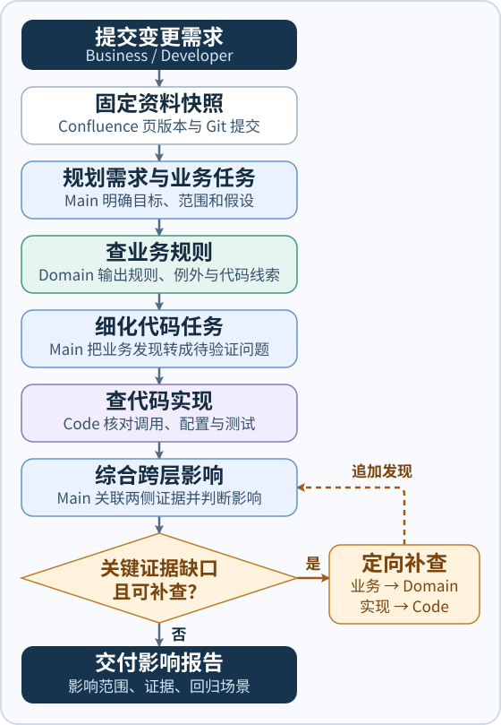
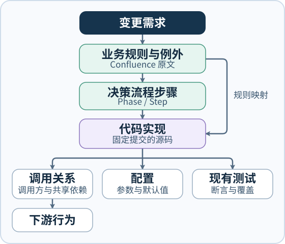
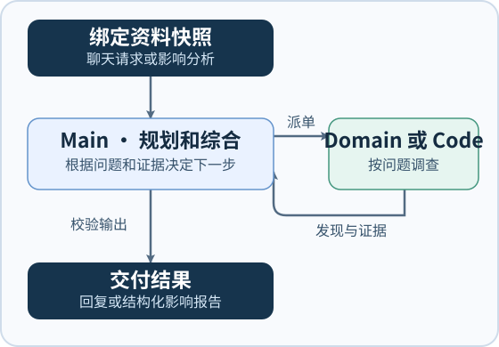

# Expected Workflow — DHub Process Impact Analyser

> 设计规格 / Target behaviour · 2026-11-26
>
> 第 1–5 节说明目标流程，第 6 节对照当前 V0 源码。工具契约见 [Expected Tools](expected-tools.md)，版本计划见 [文档索引与路线图](README.md#版本路线图)。V0 交付范围以 [PoC Requirements](poc-requirements.md) 为准。

## 1. 目的与输入输出

Business 或 Developer 提出拟议变更（Change Request），系统在开发前调查其对 DHub 的业务规则、Decision Process、代码、配置和测试的影响，并提供可回溯的证据。系统不自动修改代码、不执行生产决策、不把拟议行为当成已经上线的行为。

- **输入**：自然语言 User Story / Change Request，可包含 Campaign、Channel、Market、Inbound/Outbound、Batch/Real-time、边界条件及期望行为。
- **知识输入**：Decision Process Baseline、DHub System Overview、Glossary、Confluence FD1–FD5 及 Core Component Documentation 的 Markdown 与元数据。
- **代码输入**：一个 Git 仓库（94% Python、4% Shell、2% PowerShell）、固定的 Git 提交及可用的 CodeGraph 索引。
- **输出**：Impact Report（现有支持程度、受影响的业务规则和流程步骤、技术修改点、间接影响、冲突、回归场景、证据和待确认项）。

## 2. Three Agents

| Agent | 职责 | 所需上下文 | 输出 |
| --- | --- | --- | --- |
| Main Process Impact Analyser | 理解需求、分配任务、综合证据、判断影响、决定补查及交付报告 | 用户需求、精简 Baseline、系统概览、术语表及调查发现 | Requirement Plan、Investigation Task、Impact Report |
| Domain Knowledge Investigator | 调查 Confluence 中的现有业务规则、例外、流程位置、适用范围与后续 FD 差异 | 业务调查任务、知识快照、已知术语 | Domain Findings、业务证据、Code Hints、知识缺口 |
| Code Investigator | 调查真实代码实现、调用依赖、配置及现有测试 | 代码调查任务、Domain Findings、固定仓库提交 | Code Findings、技术证据、依赖关系及待验证项 |

Cross-layer Process Impact Analysis 是 Main Agent 的综合能力，不是第四个 Agent。Decision Process Baseline 是导航上下文，不是第四个 Agent，也不是此系统需要执行的业务流程。

### Decision Process Baseline

调查以 FD2 Requirements → Decisioning Process 的 21 步为起点，用它定位现有规则。每次仍须核对规则原文、后续 Feature Drop（FD）、代码提交和部署状态。

| Phase | Steps | 调查位置 |
| --- | --- | --- |
| P1 Initialization | 1–3 | 客户和渠道上下文、加载活跃 Campaign、渠道筛选 |
| P2 Multi-Layered Eligibility Filtering | 4–8 | Campaign、Channel、Communication Strategy eligibility、实时上下文、客户旅程 |
| P3 Business Value Calculation | 9 | 计算 Arbitration Score |
| P4 Contact Permissions | 10–13 | Contact Policy、Suppression Rules |
| P5 Final Arbitration & Fatigue Management | 14–20 | UCG、Gradual Rollout、排序、冲突解决、Step 18 Frequency Cap、Quiet Time、Channel Limit、Mobile Slot Suppression |
| P6 Delivery | 21 | 推送选定的 Campaign |

例如，算分在 P3，按分数排序在 P5。CEH Eligibility 的实际接入位置需要文档或源码证据。当前共享提示词提供了 [六阶段精简基线](../dhub/prompts/common.md#decision-process-baseline)，完整的系统概览、术语表及规则来源仍需补齐。

## 3. Expected Workflow



从上往下读主线。Domain 先确认业务语义、例外和范围，再由 Main 将这些发现转成代码调查问题。右侧虚线表示补查发现回到 Main。V0 的「可补查」要求预算充足且本次运行尚未补查，Investigator 可在该轮内多次调用工具。未来可评估为已有明确技术入口的需求增加路由。

### Step 0 — Bind Source Snapshots

- 将此次调查与一个 Confluence 内容快照和项目仓库的 commit SHA 绑定。
- CodeGraph 索引必须与被调查 commit 对齐；否则使用搜索和源码阅读，并记录图覆盖缺口。
- 保存来源状态、FD 覆盖、缺失页面和仓库可用性。禁止在同次调查中悄悄切换到更新的规则或代码。

### Step 1 — Understand Requirement（Main）

保留用户原文，提取目标、变更类型、对象、作用范围、期望行为、保持不变的行为和假设。用 Baseline 初步判断可能涉及的 Phase / Step，形成业务调查问题，而非先确定代码修改结论。

例如用户明确限定 Outbound 时，不能将 Inbound 也纳入默认变更范围。范围不明确但仍可调查时记录假设和待确认项；无法形成有效任务时才要求补充需求。

### Step 2 — Investigate Domain Knowledge（Domain）

1. 从业务任务提取术语、别名、配置名和候选 Step。
2. 通过目录和检索找到 Confluence 候选章节；打开原文核对适用条件、表格、例外和上下文。
3. 核对相关后续 FD、链接页面与冲突描述；区分 documented、proposed、superseded、unknown。FD 序号、页版本和实际部署状态是不同概念。
4. 返回 Domain Findings：规则、冲突、适用范围、Phase/Step、原文证据、Code Hints 和待代码确认的问题。

Domain Agent 可以提供候选函数名或配置键，但不能凭文档声称某个实现已部署。

### Step 3 — Refine Code Investigation Task（Main）

将 Domain Findings 转成具体可验证的问题。任务需要包括：

- 待确认的业务规则、例外及限定范围；
- 相关 Phase/Step 和原文 evidence IDs；
- Code Hints（术语、可能的函数/配置命名）；
- 要确认的现有逻辑、调用方、共享依赖、配置和测试；
- 已知假设、禁止擅自扩展的范围。

该步骤是目标职责。V0 将 `domain_findings` 连同 `plan` 和 `requirement` 直接传给 Code Investigator，由 Code 组织首轮查询。Main 在双方完成首轮调查后才综合和决定补查。 [首次代码调查和补查对照](agent-spec.md#与-expected-workflow-的差异)

### Step 4 — Investigate Code（Code）

1. 核对仓库版本与索引可用性，定位候选实现。
2. 用 CodeGraph 和字面搜索查找符号、caller/callee、调用链与共享实现；按需翻页。
3. 读取真实带行号源码，确认条件分支、参数、配置读取、默认值及调用侧差异。
4. 查阅已有测试断言和下游消费者；跨仓库依赖必须有源码、接口契约或配置证据，不能靠同名函数推断。
5. 返回 Code Findings，包括实现、依赖、配置、现有测试、证据和技术限制。

读取现有测试不等于执行测试。代码提交中的行为也不等于生产部署行为。

### Step 5 — Cross-layer Process Impact Analysis（Main）

Main 在本次运行内从需求追溯到规则、流程步骤和实现，再核对实现如何影响调用方、配置、测试和下游行为。



每条关系都需要说明为什么相关、适用什么范围、由什么证据支持。单纯的流程先后顺序或 CodeGraph 邻接关系不能直接证明下游代码必须修改。

Main 应区分：

| 结论 | 含义 |
| --- | --- |
| Existing support | 已支持、部分支持、需要变更或未知 |
| Direct change | 新需求直接改变的规则、流程行为或实现 |
| Indirect effect | 候选集合、调用方或下游行为可能受影响 |
| Verify | 共享函数、配置、测试等需要确认，未必需要修改 |
| Conflict | 文档之间、文档与实现或新需求与现有规则存在差异 |
| Open question | 当前证据不足，无法确认 |

结论需要与本次读取的 Evidence ID 对应。预期行为是根据需求推导的，不是已经验证的新实现。

### Step 6 — Targeted Follow-up（Main + Investigator）

如果存在影响最终结论的关键缺口，且预算允许：

- 业务适用范围、后续 FD、例外条件不清楚 → 交 Domain 补查。
- 实现分支、共享调用、配置或测试不清楚 → 交 Code 补查。
- 补查任务携带明确问题、之前的发现及相关证据，避免重复无目标的搜索。
- 调查结果追加到现有发现，再由 Main 综合。V0 最多一轮补查；预算耗尽或资料不可访问时，保留有证据的结论并说明限制。

V0 默认预算为每次 Investigator 派单 8 次工具、每次 run 合计 24 次工具、运行目标时限 180 秒。它们是 PoC 约束，不是完整分析的质量保证。

### Step 7 — Generate Impact Report（Main）

报告至少包含需求摘要、假设、现有支持程度、影响项（类型、对象、原因、确定性、证据和关联）、回归场景（当前/拟议行为）、覆盖范围、待确认事项。Trace 提供实际工具调用及来源定位。无证据的确认项必须降级。

## 4. Agent Handoff Contract

下列是逻辑数据契约；不是声称当前代码已经有这些独立的 Pydantic 类型。

| 数据对象 | 关键字段 |
| --- | --- |
| RequirementPlan | original_requirement, goal, scope, assumptions, expected_behaviour, unchanged_behaviour, business_questions |
| InvestigationTask | target_agent, questions, scope, constraints, hints, prior_evidence_ids, prior_findings（补查时） |
| DomainFindings | rules[], conflicts[], code_hints[], coverage, open_questions[] |
| CodeFindings | implementations[], dependencies[], configurations[], existing_tests[], coverage, open_questions[] |
| Evidence | evidence_id, source_type, excerpt, tool_span_id；文档 page_id/version/section，代码 repo_id/commit_sha/path/lines |
| ImpactReport | requirement_summary, assumptions, current_support, impact_items[], regression_scenarios[], coverage, open_questions[], evidence[] |

Domain / Code 的每条事实应携带 evidence_ids。Graph State 或单次运行共享 Runtime 保存这些数据；工具由各 Agent 白名单控制，不由另一个 Investigator 随意调用。Main 负责调度，不需要直接具备全部搜索工具。

## 5. Example — Frequency Cap

需求：Mandatory outbound campaigns should no longer bypass the frequency cap, even when Allow mandate campaign override is enabled.

| 阶段 | Expected Result（以合成示例说明） |
| --- | --- |
| Main Plan | 限定 Outbound Mandatory；确认超额时不得豁免；保留 Inbound 原行为 |
| Domain | 查到 P5 Step 18 与 override 配置、例外规则及文档依据 |
| Main Refine | 要求查共享 Frequency Cap 实现、两个入口、配置读取、测试、下游候选集合 |
| Code | 核对 should_allow_campaign、Inbound/Outbound caller、配置及现有断言 |
| Main Analyse | Outbound 为直接行为变更；Inbound 为共享逻辑隔离验证；Delivery 可能因候选减少而间接受影响 |
| Follow-up | 如缺配置、已有测试或下游证据，则定向补查 |
| Report | 超额且 override 开启时 Outbound Mandatory 从放行改拦截；Inbound 保持原行为；提供证据与回归场景 |

### V0 离线演示的实际调用

| 阶段 | 执行内容 |
| --- | --- |
| Main 规划 | 归一化需求字符串，匹配内置 `DEMO_REQUIREMENT` 后标记 `demo_case` |
| Domain 首查 | 浏览目录，按 `mandatory campaign frequency cap` 搜索，读取 `DEMO-FD2` 的 Phase 5 / Step 18 和 `DEMO-SETTINGS` 的 Frequency Cap。返回 `should_allow_campaign`、`allow_mandate_campaign_override` 两个代码线索 |
| Code 首查 | 查询两个合成仓库的版本，搜索共享函数，取 CodeGraph 首条关系，读取 `frequency.py`、`inbound.py`、`outbound.py` |
| Main 第一次综合 | 为该示例请求一次代码补查 |
| Code 补查 | 按需调用 `codegraph_read_result` 取后续窗口。读取 `global_settings.json`、`test_frequency.py`、`channel/delivery.py` |
| Main 出报告 | `offline_report` 将实际读取的证据 ID 绑定到演示报告，再经 `ground_report` 校验引用 |

**沿证据追踪影响。** P5 Step 18 的旧豁免条件对应共享函数 `should_allow_campaign`。Outbound 是直接变更范围，Inbound 调用用于验证共享逻辑的隔离。override 配置的适用语义与 Quiet Time 分别核实，现有断言用来定位要补的回归场景。进入 Delivery 的候选活动可能减少，这项发现用于检查下游影响。

| Frequency Cap 输入 | 示例现有行为 | 拟议行为 |
| --- | --- | --- |
| Outbound Mandatory，豁免开启，超额 | 放行 | 拦截 |
| Outbound Mandatory，豁免关闭，超额 | 拦截 | 拦截 |
| Outbound Mandatory，未超额 | 放行 | 放行 |
| Outbound Marketing，超额 | 拦截 | 拦截 |
| Inbound Mandatory，豁免开启，超额 | 放行 | 放行 |

表格只描述合成案例中 Frequency Cap 这一步的判断。演示报告在读到相应来源时将 P5 Step 18 和豁免规则标为 `confirmed`，配置、测试和下游等有证据的发现标为 `potential`。其他需求在离线模式仅做基础检索并返回覆盖说明。真实项目行为需要通过内网资料和模型联调核实。 [PoC Acceptance](poc-acceptance.md) · [offline_report](../dhub/agents/main.py)

## 6. Workflow 与当前实现的边界

### 6.1 LangGraph 节点与实际交接



`analyze` 先由 `Sources` 绑定并登记快照，再进入 `_run_workflow`。菱形表示从 `synthesize` 出发的条件边。 [analyzer.py](../dhub/analyzer.py) · [sources.py](../dhub/sources.py)

项目模式可配置一个仓库。当前 `analyze` 仍会在仓库数量少于两个时记录覆盖不足，因此单仓库分析即使成功生成报告，运行状态也会是 `partial`。演示模式仍从两个合成仓库绑定快照。 [analyzer.py](../dhub/analyzer.py) · [配置解析](../dhub/config.py)

| 目标步骤 | V0 节点或函数 | 实现状态与实际交接 |
| --- | --- | --- |
| Step 0 固定资料快照 | `analyze` → `Sources.snapshot` | **已实现。** 在进入 LangGraph 前绑定并登记文档和代码版本 |
| Step 1 规划需求 | `plan_requirement` → `main.plan` | **已实现基础。** 使用原始需求生成 plan，在线输出受提示词约定 |
| Step 2 查业务规则 | `investigate_domain` → `domain.run` | **已实现基础。** 使用需求、plan、快照，按需调用四个业务工具，将 Domain findings 存入 `state["domain"]` |
| Step 3 细化代码任务 | `investigate_domain` → `investigate_code` | **独立步骤待实现。** 当前直接进入 Code，首次调查的 `task` 为 `None` |
| Step 4 查代码实现 | `investigate_code` → `code.run` | **已实现基础。** 接收原需求、plan、Domain findings 和快照，按需调用五个代码工具，将 Code findings 存入 `state["code"]` |
| Step 5 综合影响 | `synthesize` → `main.synthesize` | **已实现基础。** 读取双方 findings、原文证据和运行限制，返回补查任务或报告 |
| Step 6 执行补查 | `follow_up_investigation` → `synthesize` | **一轮回流已实现。** 通过任务的 `agent` 选 Investigator，追加 findings，清空 `follow_up`，并设置 `followed_up=True` |
| Step 7 返回报告 | `main.synthesize` → `ground_report` → `END` | **结构与引用校验已实现。** 返回报告及可定位证据，结论与原文的语义对齐待补齐 |

在线模式仅在尚未补查、预算充足且模型返回有效 `agent` 与非空 `question` 时走补查边。Domain 收到的 `domain_findings` 为空列表，Code 收到 Domain findings，在线任务的历史 Code findings 待补齐。离线样例固定发起一次 Code 补查，并从首次 Code 调查保存的结果接着翻页。 [Main](../dhub/agents/main.py) · [Domain](../dhub/agents/domain.py) · [Code](../dhub/agents/code.py)

### 6.2 从网页请求到报告

```text
POST /api/runs
  app.create_run → RunStore.create_run → executor.submit
  app._execute_run → analyzer.analyze
    Sources 绑定文档和仓库快照 → AgentRuntime → LangGraph
    Investigator 调查 → Main 综合 → ground_report
  RunStore.finish_run

GET /api/runs/{run_id}                       → 快照、状态、报告
GET /api/runs/{run_id}/events?after_seq={n}   → 增量 Trace
```

FastAPI 以单工作线程排队执行分析，SQLite 保存状态、报告及 Trace，网页轮询读取结果。在线 LLM 模式走 Chat Completions 的原生 `tool_calls`。LangGraph 决定角色顺序和是否补查，`AgentRuntime` 在单次 Investigator 调查内执行模型和工具的循环。离线模式由 `run_offline` 执行固定脚本。 [Web 与 Trace 契约](api-ui-trace.md)

### 6.3 State、Runtime 与证据校验

- **Graph State** 定义为 `TypedDict`。保存 `requirement`、`plan`、`domain`、`code`、`follow_up`、`followed_up`、`report`。在线 plan 按提示词要求包含 `goal`、`scope`、`assumptions`、`business_questions`、`code_questions`。计划和双方 findings 依赖提示词约定的 JSON 字段，强类型任务与发现契约仍待实现。 [Main 规划提示词](../dhub/prompts/main-plan.md)
- **AgentRuntime** 保存单次运行的快照、证据、工具计数、截止时间、限制说明和 Trace emitter。在线角色提示词由 `load_system_prompt` 拼接 `common.md`。Investigator 调用模型后按白名单执行工具，将 `role=tool` 结果送回模型，再取得 findings。运行时检查剩余时间，外部适配器需要设置自己的调用超时。
- **Report** 由 Pydantic 校验。现有支持状态为 `supported`、`partially_supported`、`change_required` 或 `unknown`。影响项的 `kind` 对应流程、规则、代码、配置、测试、下游或冲突，`effect` 表示直接变更、间接影响或需核实，`status` 表示已确认、潜在或未知。`related_item_ids` 记录本次报告内的关联，回归场景保留 `given`、`before`、`proposed` 和证据引用。
- **ground_report** 去掉未知证据 ID 和无效关联。没有有效引用的现有支持或确认项降为 `unknown`，无证据的场景清空 `before`。当前校验的范围是引用能否定位，引用是否支持具体结论仍需核对原文。超时、缺资料等限制随报告返回。

[角色实现](../dhub/agents/) · [AgentRuntime](../dhub/agent_runtime.py) · [Report schema 与 ground_report](../dhub/report.py)
